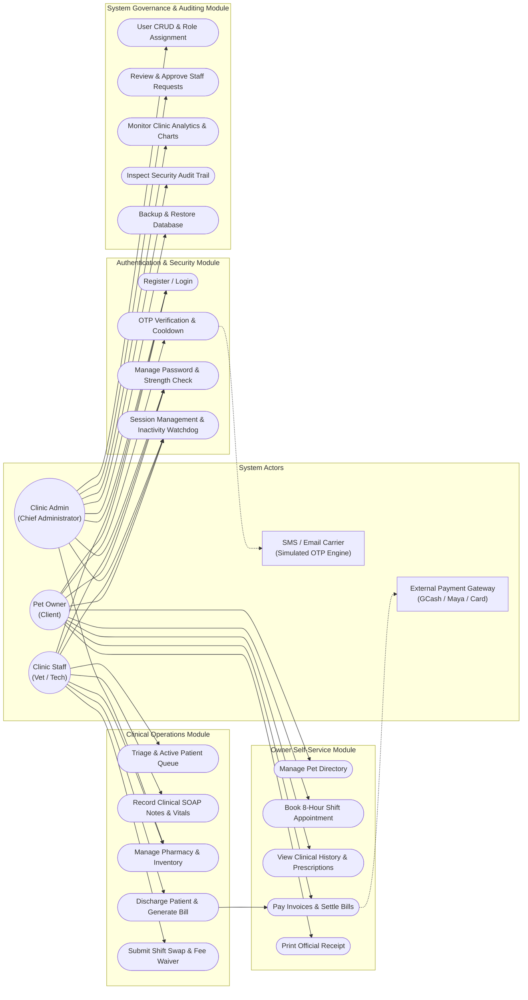
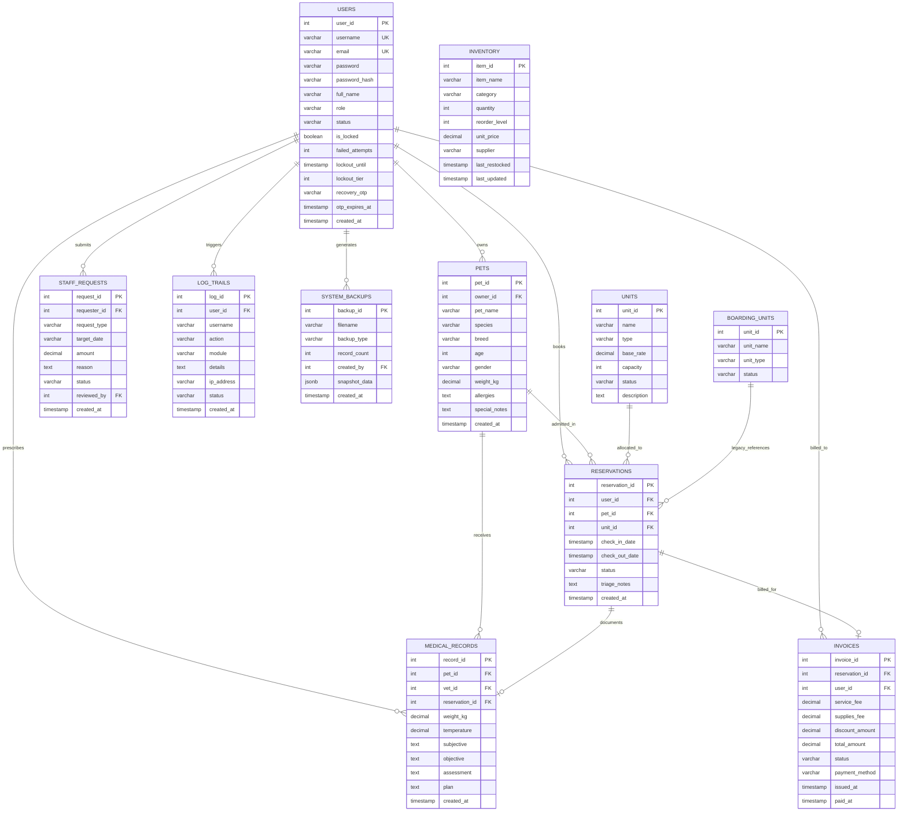
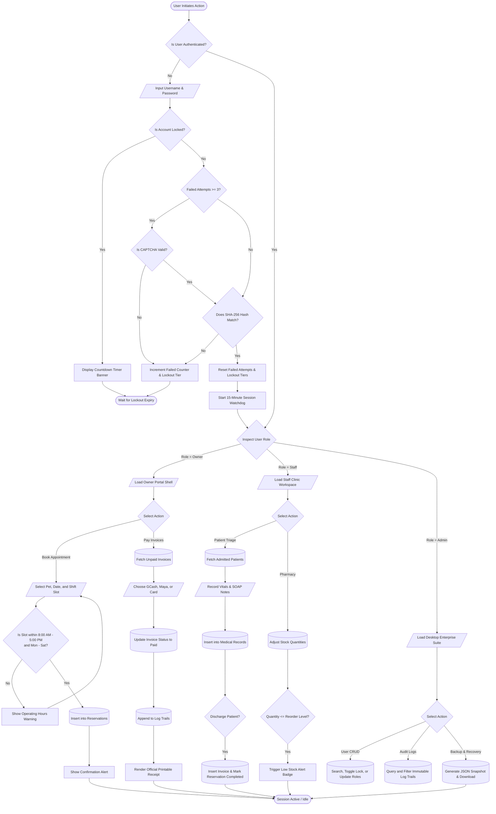
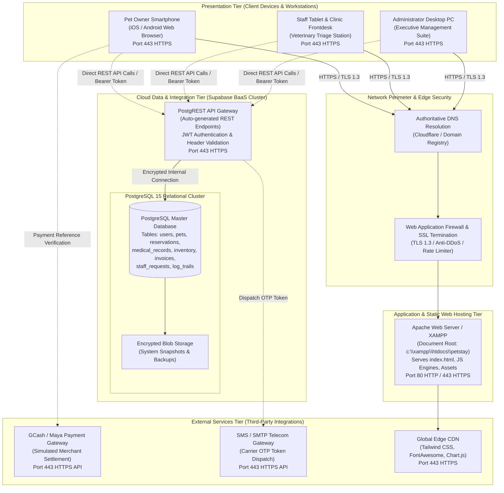

# System Integration & Architecture (SIA) Documentation
## PetStay: Enterprise Veterinary Clinic Management & Security Platform

**Academic Course**: IT/CS-SIA312 – System Integration & Architecture  
**Evaluator**: CICTE Faculty / Architecture Board  
**Target System**: PetStay Enterprise Veterinary Clinic Management & Security Platform  
**System Classification**: Distributed Multi-Tier Mobile & Enterprise Web Architecture  

---

### Executive Architectural Overview

PetStay is an integrated multi-tier veterinary clinic management and security system designed for seamless collaboration among Pet Owners, Clinic Staff (Veterinarians and Veterinary Technicians), and Clinic Administrators. The architecture couples a high-performance **Single-Page Application (SPA)** client tier (responsive dynamic mobile and desktop shell) with a cloud-native **Database-as-a-Service (DBaaS)** PostgreSQL backend via RESTful APIs, enforced by Information Assurance and Security (IAS 1) protocols including SHA-256 cryptographic hashing, progressive lockout protection, single-use OTP tokens, session watchdog timers, and immutable audit trails.

---

### 1. Use Case Diagram (System Users & Functionalities)

The diagram below identifies the three primary system actors (**Pet Owner**, **Clinic Staff / Veterinarian**, and **Clinic Administrator**) along with the external **Payment Gateway & SMS Carrier Services**, defining their relationships with core functional and security use cases according to standard UML conventions.

---

### 2. System Flow Diagram (Swimlanes & Pools)

The Swimlane Process Flow Diagram models the end-to-end clinical lifecycle—from appointment booking through veterinary triage, SOAP documentation, discharge invoicing, customer payment, and administrative audit logging.

```mermaid
flowchart TD
    subgraph Pool_PetStay["PetStay Clinic End-to-End Operational Lifecycle"]
        
        subgraph Lane_Owner["Pet Owner Lane"]
            O_Start(["Start: Owner Logs In"])
            O_Book["Select Pet & Schedule 8-Hour Shift Slot\n(08:00 AM - 05:00 PM)"]
            O_Wait["Wait for Clinic Day Arrival"]
            O_Pay["Receive Discharge Bill & Settle via GCash/Maya/Card"]
            O_Rcpt["Download / Print Official Receipt"]
            O_End(["End: Patient Returned Home"])
        end

        subgraph Lane_Staff["Clinic Staff / Veterinarian Lane"]
            S_Queue["Review Clinic Queue & Admit Patient"]
            S_Exam["Perform Clinical Physical Examination"]
            S_SOAP["Record SOAP Note:\n(Subjective, Objective, Assessment, Plan)"]
            S_Inv["Dispense Medications & Deduct Inventory"]
            S_Discharge["Initiate Patient Discharge & Issue Invoice"]
        end

        subgraph Lane_System["PetStay System / Gateway Lane"]
            Sys_Validate["Validate 8-Hour Shift & Enforce Operating Rules"]
            Sys_CreateApt["Create Reservation (Status: Pending -> Approved)"]
            Sys_UpdateInv["Update Pharmacy Stock & Low Reorder Thresholds"]
            Sys_GenInvc["Calculate Total Bill & Generate #INV-XXXXX"]
            Sys_ProcessPay["Process Transaction & Update Invoice to PAID"]
            Sys_Log["Append Immutable Security Event to Log Trail"]
        end

        subgraph Lane_Admin["Clinic Administrator Lane"]
            A_Monitor["Monitor Real-time Clinic Analytics & Capacity"]
            A_Review["Review Audit Trails & Approve Staff HR Requests"]
        end
    end

    %% Flow transitions across swimlanes
    O_Start --> O_Book
    O_Book --> Sys_Validate
    Sys_Validate --> Sys_CreateApt
    Sys_CreateApt --> O_Wait
    O_Wait --> S_Queue
    S_Queue --> S_Exam
    S_Exam --> S_SOAP
    S_SOAP --> S_Inv
    S_Inv --> Sys_UpdateInv
    Sys_UpdateInv --> S_Discharge
    S_Discharge --> Sys_GenInvc
    Sys_GenInvc --> O_Pay
    O_Pay --> Sys_ProcessPay
    Sys_ProcessPay --> Sys_Log
    Sys_ProcessPay --> O_Rcpt
    O_Rcpt --> O_End

    Sys_Log -.-> A_Review
    Sys_UpdateInv -.-> A_Monitor
```

---

### 3. Entity Relationship Diagram (ERD)

The Entity Relationship Diagram specifies the relational database schema implemented in `petstay_schema.sql` and deployed on the cloud PostgreSQL database. It captures all primary keys (`PK`), foreign keys (`FK`), attributes, and entity relationships.

---

### 4. System Flowchart (Operational Logic & Decisions)

The flowchart maps the algorithmic decisions within the system—including authentication validation, progressive lockout tiers, CAPTCHA challenges, 8-hour operational shift enforcement, clinical SOAP recording, and online payment settlement.

---

### 5. Network Diagram (Network Flow & Tier Architecture)

The Network Diagram visualizes the distributed network topology, communication boundaries, protocols, and data flow between client devices, web servers, cloud database clusters, and external third-party services.

---

### Architectural Consistency & Verification Matrix

| Architecture Component | Diagram 1: Use Case | Diagram 2: Swimlane | Diagram 3: ERD | Diagram 4: Flowchart | Diagram 5: Network |
| :--- | :--- | :--- | :--- | :--- | :--- |
| **User Roles** | Owner, Staff, Admin | Owner, Staff, Admin | `users.role` | CheckRole Split | Client Devices |
| **8-Hour Shift Appointments** | UC6 | Owner & System Lanes | `reservations`, `units` | ValidateShift | Mobile/Web to API |
| **Clinical SOAP Notes** | UC11 | Staff Lane (Exam) | `medical_records` | WriteSOAP Decision | Staff Tablet to API |
| **Pharmacy / Stock Alerts** | UC12 | Staff Lane (Dispense) | `inventory` | CheckLowStock | Admin/Staff Console |
| **Billing & Payments** | UC8, UC9 | Owner & Gateway Lanes | `invoices` | ProcessPay & Receipt | Payment Gateway |
| **Security & Audit Logs** | UC18 | System Lane | `log_trails` | AppendLog1 | PostgreSQL Cluster |
| **Backup & Recovery** | UC19 | Admin Lane | `system_backups` | CreateBackup | Blob Storage |

---

### 7. Official SIA Defense Presentation Blueprint (PowerPoint .pptx)

The complete presentation artifact has been compiled into **`PetStay_SIA_Architectural_Blueprints.pptx`**, matching the official **Western Leyte College of Ormoc (CICTE)** capstone defense format in 16:9 widescreen layout (`13.33" x 7.5"`), featuring high-contrast dark-emerald styling, institutional branding, and full technical specifications across 7 slides:

1. **Slide 1: Cover Slide** — Western Leyte College of Ormoc, CICTE Header, PetStay Capstone Title, Evaluators (Mr. Roel Daniot & Mr. Ian Celmar Avila), and 5-Blueprint Specification Box.
2. **Slide 2: SIA DIAGRAM 1 OF 5** — UML Use Case Diagram (System Actors, UC-01 to UC-13, Cloud Boundaries).
3. **Slide 3: SIA DIAGRAM 2 OF 5** — BPMN Swimlane Process Flow Diagram (Cross-functional interaction across Pet Owner, Clinic Staff, Core Engine, Supabase, and Admin).
4. **Slide 4: SIA DIAGRAM 3 OF 5** — Entity-Relationship Diagram (ERD) (PostgreSQL 15 relational schema: 10 production tables, foreign keys, cardinality).
5. **Slide 5: SIA DIAGRAM 4 OF 5** — System Logic Flowchart (End-to-End Decision Tree: SHA-256 Auth, 3-Tier Lockout, CAPTCHA, and Sunday Shift Exclusion Filter).
6. **Slide 6: SIA DIAGRAM 5 OF 5** — Network Architecture Diagram (5 distributed multi-tier layers: Presentation, Perimeter, Web Hosting, Supabase BaaS, and Cloud Gateways).
7. **Slide 7: Summary Matrix** — Architectural Diagram Specifications Summary Matrix mapping all 5 diagrams to academic notations, target subsystems, and security controls.

---

### 8. Operational Policy: Sunday Booking & Schedule Exclusion Rule

To ensure strict compliance with clinic labor regulations and operational shift policies:
- **Operating Days**: Monday through Saturday only (8:00 AM – 5:00 PM).
- **Sunday Prohibition**:
  - **Database Level**: All legacy Sunday appointments have been migrated to Monday (`2026-10-12`). All active reservations adhere to valid operating days.
  - **API Layer**: `PetStayDB.Reservations.create()` actively asserts `new Date(check_in_date).getDay() !== 0`.
  - **Client UI**: The appointment modal date picker restricts initial selection to valid weekdays, auto-advances any picked Sunday to Monday, displays real-time warning toasts (`"Clinic is closed on Sundays"`), and displays explicit badges (`"Mon–Sat Only (No Sundays)"`).

---
*Documentation compiled and formatted in accordance with standard UML 2.5, BPMN 2.0, Crow's Foot ERD, and ISO/IEC 25010 System Architecture specifications.*
